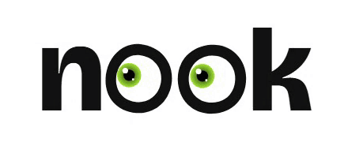
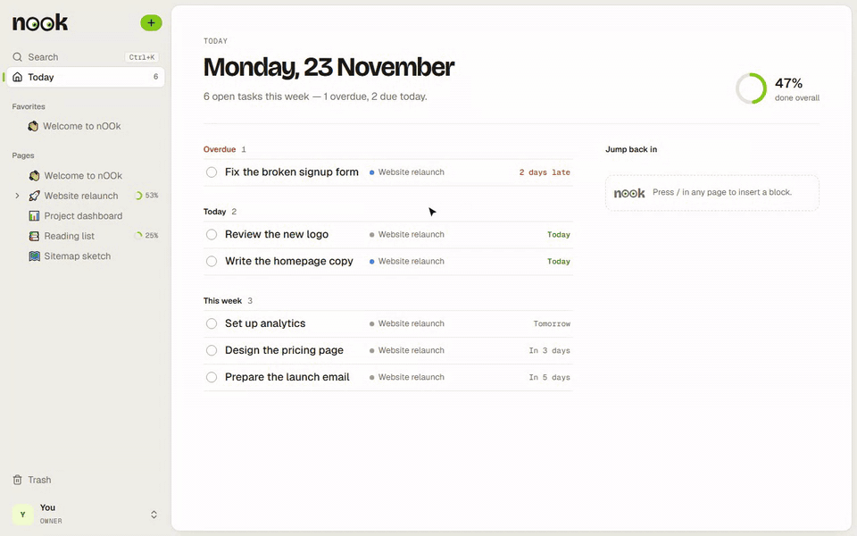
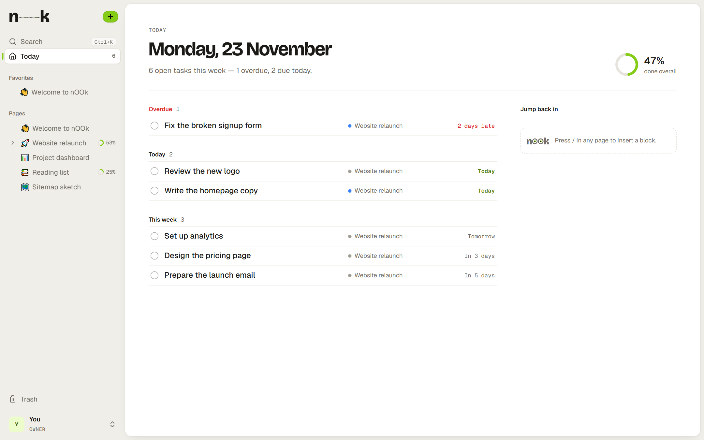
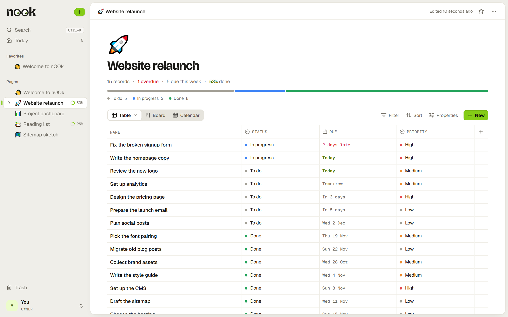
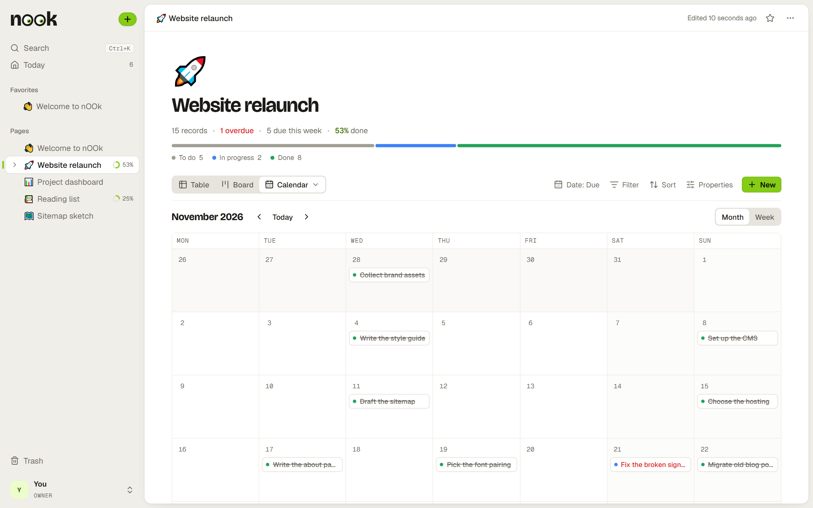
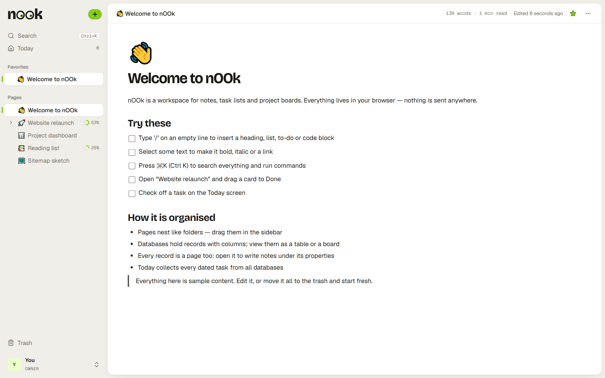
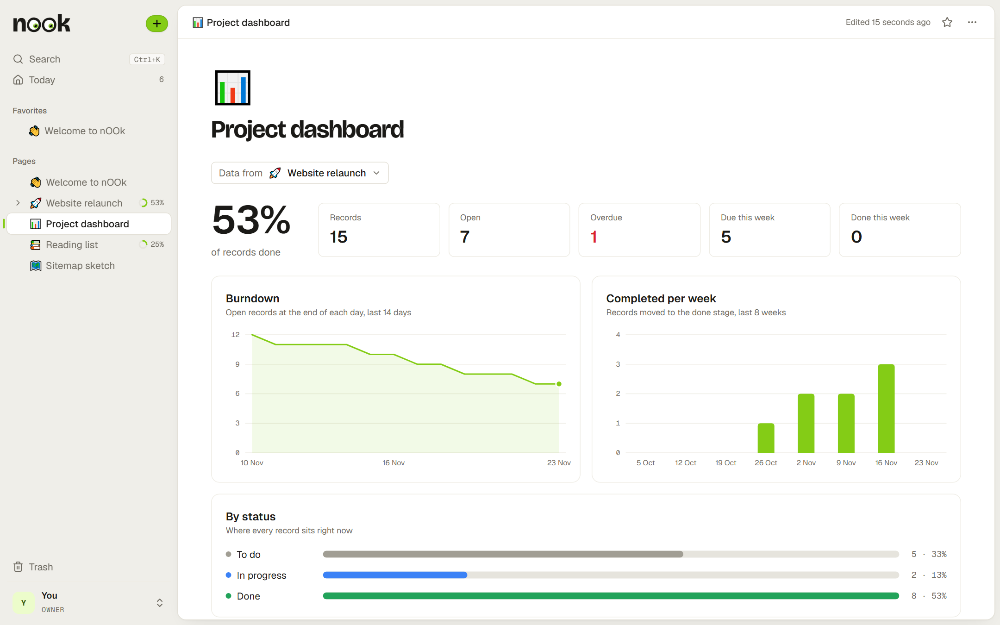
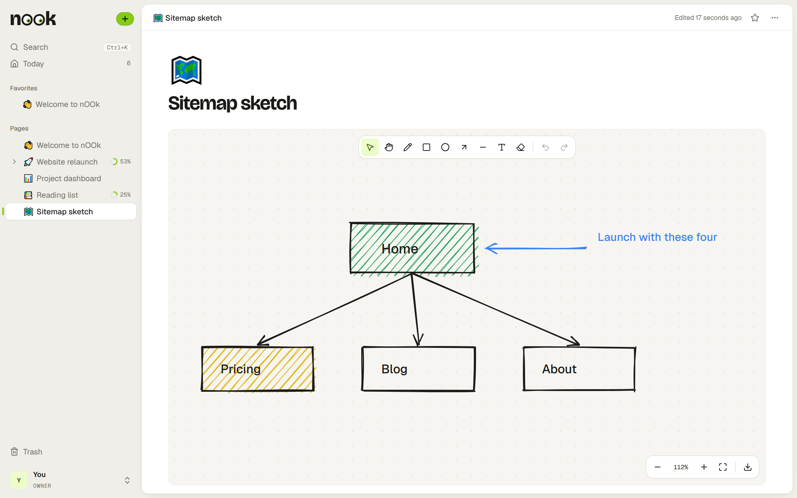
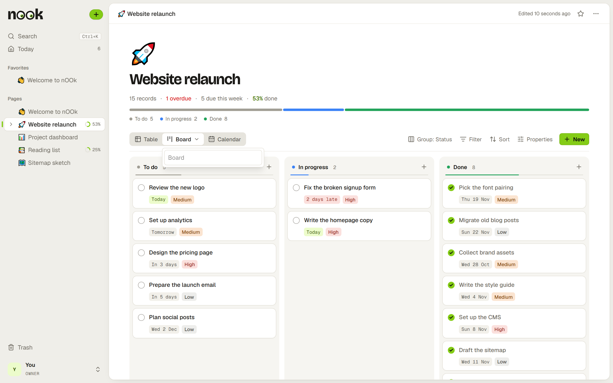
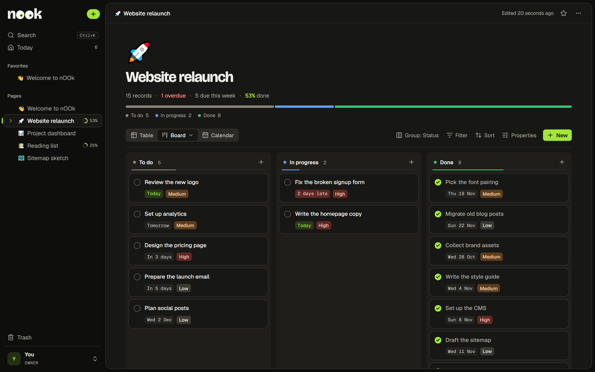

<p align="center">
  <picture>
    <source media="(prefers-color-scheme: dark)" srcset="docs/logo-dark.gif">
    
  </picture>
</p>

<p align="center">
  <strong>A Notion-style workspace that lives entirely in your browser.</strong><br>
  Pages, databases, documents, a whiteboard and dashboards, with no backend and no sign-up.
</p>

<p align="center">
  <a href="https://cris0001.github.io/nook/"><strong>Open the live demo →</strong></a>
</p>

<p align="center">
  <a href="https://github.com/cris0001/nook/actions/workflows/ci.yml"></a>
  <a href="https://github.com/cris0001/nook/actions/workflows/deploy.yml"></a>
  
  
  
  
  
</p>

<p align="center">
  
</p>

---

The double O in the name is a pair of eyes. They follow your cursor, glance around when you stop moving and blink now and then. Everything else in the app stays quiet so the content stands out: warm neutrals, hairline borders and lime as the only accent.

Everything you create is saved in IndexedDB on your own device. Open the demo and you get a sample workspace to explore. Nothing is ever sent to a server.

## What's inside

|                |                                                                                                                                                                  |
| -------------- | ---------------------------------------------------------------------------------------------------------------------------------------------------------------- |
| **Pages**      | A nested tree you can drag to reorder or re-parent. Emoji icons, favorites, recently opened pages, breadcrumbs, and a trash with restore.                        |
| **Databases**  | Text, number, date, select, multi-select, checkbox and URL properties. Inline editing, sorting, filtering, and saved views as tabs. Every record is also a page. |
| **Board**      | A Kanban board grouped by any select property. Drag cards and columns, and add, rename or recolor columns. Overdue cards are marked.                             |
| **Calendar**   | A month or week grid built from a date property. Drag a record to another day to change its date, or click a day to create a record.                             |
| **Documents**  | A Tiptap block editor with a `/` menu, Markdown shortcuts, draggable blocks, a selection toolbar, `@` mentions and backlinks.                                    |
| **Whiteboard** | An infinite, hand-drawn canvas built for this project with Rough.js and perfect-freehand. Pen, shapes, arrows and text, plus undo/redo and PNG export.           |
| **Dashboard**  | Burndown, completions per week, records by status and stat tiles. The charts are small SVG components with no chart library.                                     |
| **Today**      | Every dated task from every database, grouped into overdue, today and this week.                                                                                 |

You also get a command palette (`Ctrl/⌘ K`), light and dark themes, English and Polish, three roles (owner, editor, viewer), JSON export and import of the whole workspace, and drag and drop that works from the keyboard.

## Screenshots

<table>
  <tr>
    <td width="50%"><p align="center"><sub>Today</sub></p></td>
    <td width="50%"><p align="center"><sub>Table view</sub></p></td>
  </tr>
  <tr>
    <td><p align="center"><sub>Calendar view</sub></p></td>
    <td><p align="center"><sub>Block editor</sub></p></td>
  </tr>
  <tr>
    <td><p align="center"><sub>Dashboard</sub></p></td>
    <td><p align="center"><sub>Whiteboard</sub></p></td>
  </tr>
  <tr>
    <td><p align="center"><sub>Board view</sub></p></td>
    <td><p align="center"><sub>Dark mode</sub></p></td>
  </tr>
</table>

## How it's built

**Stack:** React 19 · Vite · TypeScript (strict, no `any`) · TanStack Router · Dexie + `useLiveQuery` · Zustand · Tailwind CSS v4 · shadcn/ui · Tiptap · dnd-kit · Rough.js · Zod · date-fns · Vitest + Testing Library

Each feature lives in its own module under `src/features/<name>/`, and the rest of the app imports it only through its `index.ts`. Inside a feature, data flows through three layers:

```
api/        plain async functions over Dexie, the only code that touches IndexedDB
  ↓
hooks/      useLiveQuery for reads, one hook per mutation
  ↓
components/ UI that talks to hooks and never to the database
```

A few decisions behind the design:

- **No TanStack Query.** There is no server to cache. IndexedDB answers in milliseconds, and `useLiveQuery` re-renders on every write, even one made in another tab. If a backend is added later, it fits behind the same `api/` + `hooks/` boundary and the components don't change.
- **Zustand holds only UI state** (modals, drafts, filters). Anything that has to persist goes to Dexie and is validated with Zod.
- **One permission matrix.** `lib/permissions` maps each role to the actions it may perform. Components ask `useCan('record.edit')` and never check role names.
- **Everything is styled with tokens.** Colors are CSS variables in `globals.css`, so the whole app can be restyled from one file. The charts and the whiteboard use the same tokens.
- **Built to handle volume.** The data menu can generate a 10,000-record workspace for stress testing. The sidebar avoids loading records, live queries are shared, and search results are capped.

```
src/
  app/          router and provider composition
  routes/       thin TanStack Router file routes
  features/     pages, databases, documents, whiteboard, dashboards, today, onboarding, splash
  components/   shared UI, shadcn primitives, the nOOk brand mark
  lib/          db, data shared between features, permissions
  schemas/      Zod schemas for everything persisted
```

## Running locally

Requires Node 22+ and pnpm.

```bash
pnpm install
pnpm dev        # http://localhost:5173
```

| Script           |                                              |
| ---------------- | -------------------------------------------- |
| `pnpm build`     | Production build into `dist/`                |
| `pnpm typecheck` | Generates the route tree, then runs `tsc`    |
| `pnpm lint`      | ESLint (type-aware)                          |
| `pnpm test`      | Vitest: unit tests and jsdom component tests |

Every push to `main` runs CI (typecheck, lint, build, tests) and deploys the app to GitHub Pages.

## Roadmap

The full plan is in [`docs/ROADMAP.md`](docs/ROADMAP.md). Ideas for later include a timeline (Gantt) view, a page graph, embeds inside documents, version history, and an optional Supabase backend for sync and real-time collaboration.
