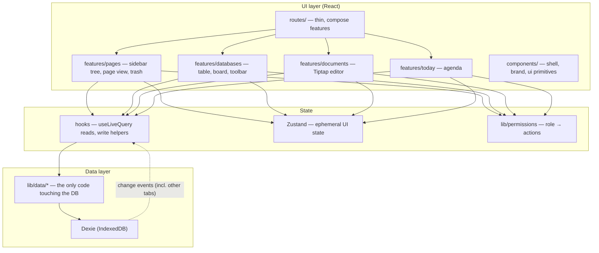
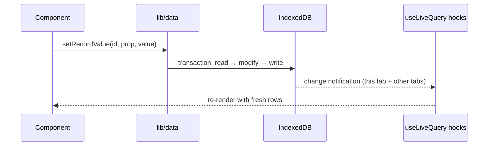
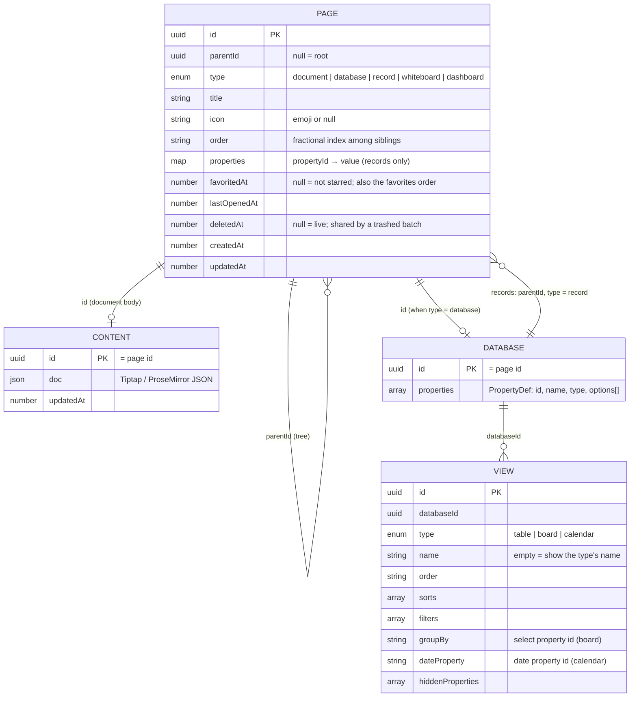

# nOOk — Front-end System Design

Written with the **RADIO** framework (GreatFrontEnd):
**R**equirements → **A**rchitecture → **D**ata model → **I**nterface → **O**ptimizations.

This is the design the project is built against. Items marked _(planned)_ are part of
the design but not implemented yet; see `ROADMAP.md` for the delivery order.

---

## 1. Requirements

### 1.1 Problem

A personal workspace in the spirit of Notion: one place for notes, task lists and
project boards, organised as a tree of pages. It is a portfolio project, so it must
run with **no backend** — everything lives in the browser — while staying ready for
a backend later.

### 1.2 Functional requirements

| #   | Requirement                                                                                    | Priority |
| --- | ---------------------------------------------------------------------------------------------- | -------- |
| F1  | Nested pages in a sidebar tree: create, rename, move (drag), duplicate, icon, favorites        | Core     |
| F2  | Trash: soft delete with restore, delete forever, undo right after deleting                     | Core     |
| F3  | Block documents: headings, lists, to-dos, quotes, code, dividers, `/` menu, drag blocks        | Core     |
| F4  | Databases: typed columns (text, number, select, multi-select, date, checkbox, URL)             | Core     |
| F5  | Database views: table and board (calendar later), each with its own filters, sorts, grouping   | Core     |
| F6  | Every record is a full page (properties on top, document below)                                | Core     |
| F7  | Today: tasks with a date across all databases — overdue, today, this week; check off with undo | Core     |
| F8  | Progress: % done per database (sidebar, header summary)                                        | Nice     |
| F9  | Roles: owner / editor / viewer, UI adapts to what the role may do                              | Core     |
| F10 | UI in English (default) and Polish, light / dark / system theme                                | Core     |
| F11 | Whiteboard, charts dashboard, calendar view, links and backlinks                               | Later    |
| F12 | Command palette (⌘K), export / import of the workspace                                         | Later    |

### 1.3 Non-functional requirements

| Area           | Target                                                                                                 |
| -------------- | ------------------------------------------------------------------------------------------------------ |
| Latency        | Every user action reflects in < 50 ms (no spinners for local data); typing never lags                  |
| Scale          | Comfortable up to ~1 000 pages and ~5 000 records per workspace on a mid-range laptop                  |
| Offline        | Fully functional offline — there is no network dependency at all                                       |
| Durability     | No data loss on reload, crash or tab close; protect against browser storage eviction                   |
| Multi-tab      | Two open tabs stay in sync without a refresh                                                           |
| Responsiveness | Desktop first, fully usable on phones (drawer sidebar, touch drag, no sideways scroll)                 |
| Accessibility  | Keyboard reachable, visible focus, proper roles on menus / tabs / checkboxes, reduced-motion respected |
| i18n           | All UI copy translated; dates and plurals follow the locale; user content never translated             |
| Evolvability   | A backend (auth, sync, collaboration) can be added without rewriting components                        |

### 1.4 Out of scope (for the MVP)

Accounts and auth, real-time collaboration, sharing links, comments, file uploads,
page history, full-text search across document bodies, server-side rendering / SEO.

### 1.5 Key assumptions

- Single user per browser profile; "roles" are previewed locally until auth exists.
- Workspaces are personal-sized (see Scale), so in-memory filtering and sorting is fine.
- Modern evergreen browsers with IndexedDB.

---

## 2. Architecture

### 2.1 Rendering and platform choice

**Client-side SPA (React + Vite).** There is no content to index and no server, so
SSR / Next.js would add infrastructure without benefit. Routing is client-side
(TanStack Router, file-based and type-safe).

### 2.2 High-level components



### 2.3 Responsibilities

| Layer               | Owns                                                               | Must not                           |
| ------------------- | ------------------------------------------------------------------ | ---------------------------------- |
| `routes/`           | URL → screen; composes features (e.g. page body by page type)      | contain logic or call the DB       |
| `features/<name>/`  | screens and components of one domain, its strings, its UI stores   | import another feature's internals |
| `hooks/`            | live reads (`useLiveQuery`), permission checks, shared behaviour   | render UI                          |
| `lib/data/`         | every read and write, transactions, invariants (batches, cascades) | know about React                   |
| `stores/` (Zustand) | ephemeral UI state: drag state, open menus, locale, theme, profile | hold persisted domain data         |
| `utils/`            | pure functions (ordering, dates, progress, tree shaping)           | have side effects                  |

### 2.4 Data flow (one write)



There is no client cache to invalidate: the database **is** the store, and live
queries re-run when the tables they read change. Writes are fire-and-forget from
the component's point of view — the UI updates when the data does.

### 2.5 Key decisions

| Decision          | Chosen                             | Alternatives                        | Why                                                                                           |
| ----------------- | ---------------------------------- | ----------------------------------- | --------------------------------------------------------------------------------------------- |
| Persistence       | IndexedDB via Dexie                | localStorage, OPFS + SQLite (wasm)  | Async, large quota, indexes, transactions, cross-tab change events; SQLite is heavier to ship |
| Server state lib  | none (`useLiveQuery`)              | TanStack Query                      | No server; the DB is local and reactive, a cache would only add invalidation                  |
| UI state          | Zustand                            | Context, Redux                      | Tiny, no providers, selector-based re-renders                                                 |
| Editor            | Tiptap (ProseMirror)               | Lexical, Slate, BlockNote           | Mature schema + commands, JSON output, Yjs path for collaboration later                       |
| Drag and drop     | dnd-kit                            | react-beautiful-dnd, native DnD     | Pointer + touch sensors, custom collision logic for tree and board                            |
| Records           | records are pages (`type: record`) | separate rows table                 | A record gets a title, icon, body, trash and duplicate for free                               |
| Sibling order     | fractional index keys              | integer positions                   | Moving an item rewrites one row; sync-friendly                                                |
| Styling           | Tailwind v4 + CSS-variable tokens  | CSS modules, CSS-in-JS              | Theming (dark, future palettes) from one file, no runtime cost                                |
| Code organisation | feature folders + public barrels   | layer folders (components/, hooks/) | Domain code stays together; boundaries are explicit                                           |

---

## 3. Data model

### 3.1 Persisted entities (IndexedDB)



Design rules:

- **Metadata and bodies are split.** `pages` rows stay small, so the tree, views and
  agenda never load rich text; a document body is read only when its page is open.
- **Values are keyed by property id**, not name, so renaming a column is one write.
  Select values store option ids; dates are `YYYY-MM-DD` strings (calendar days, no
  time-zone drift).
- **Conventions instead of extra schema:** the first select column is the status; its
  last option means done. Used by board, progress, Today.
- **Soft delete in batches:** a page and its subtree share one `deletedAt`, so restore
  brings back exactly that batch.
- **Every row has a uuid, `updatedAt`, and deletes are soft** — the prerequisites for
  syncing later.
- Schema changes go through Dexie versions with upgrade functions; Zod schemas define
  the shapes and validate data entering from outside (import) _(planned)_.

### 3.2 Client-only state (not persisted in IndexedDB)

| State                         | Where                  | Lifetime                      |
| ----------------------------- | ---------------------- | ----------------------------- |
| Active route, open page       | URL (TanStack Router)  | shareable, back/forward works |
| Active view tab of a database | component state        | per visit                     |
| Expanded tree nodes           | Zustand + localStorage | across reloads                |
| Drag targets, rename-in-place | Zustand                | during the interaction        |
| Locale, theme, profile/role   | Zustand + localStorage | across reloads                |
| Splash seen                   | sessionStorage         | per browser session           |

### 3.3 Derived data (computed, never stored)

Tree shape, breadcrumbs, favorites and recents lists, filtered/sorted view rows,
board columns, agenda buckets, progress ratios. Pure functions in `utils/`, unit
tested, recomputed from live rows.

---

## 4. Interface definition

### 4.1 Routes

| Path         | Screen                                                                 |
| ------------ | ---------------------------------------------------------------------- |
| `/`          | Today (agenda) + "Jump back in"                                        |
| `/p/$pageId` | Any page; the body is chosen by page type (document, database, record) |
| `/trash`     | Trash                                                                  |

### 4.2 Data API (`lib/data`) — the contract a backend would implement

```ts
// pages
listPages(): Promise<Page[]>
getPage(id): Promise<Page | undefined>
createPage({ parentId, type, title?, properties? }): Promise<Page>
renamePage(id, title) · setPageIcon(id, icon | null) · toggleFavorite(id)
markPageOpened(id) · movePage(id, { parentId, order })
duplicatePage(id): Promise<Page>          // deep copy incl. databases, views, bodies
trashPage(id) · restorePage(id) · listTrash() · deletePageForever(id)

// databases
createDatabase(parentId, title, starterNames?): Promise<Page>
getDatabase(id) · listViews(id) · listRecords(id) · getDatabaseProgress(id)
addRecord(databaseId, properties?, title?) · setRecordValue(recordId, propertyId, value)
toggleRecordOption(recordId, propertyId, optionId, multi)
moveRecord(recordId, propertyId, optionId | null, order | null)   // board drop
addProperty · renameProperty · reorderProperties · deleteProperty   // cascades to values and views
addOption · updateOption · reorderOptions · deleteOption            // cascades to values and filters
updateView(id, patch) · addView · deleteView                        // a database keeps ≥ 1 view

// documents
getContent(pageId) · saveContent(pageId, doc)
```

Guarantees: multi-step changes run in one transaction; cascades (deleting a column,
an option, a page) leave no dangling references; reads exclude trashed rows unless
asked for the trash.

### 4.3 Hooks (read side)

`usePages`, `usePage(id)`, `usePageTree`, `useTrash`, `useDatabase(id)` (database +
views + records in one live query), `usePageContent(id)`, `useAgenda`,
`useDatabaseProgress(id)`. Each returns a discriminated union:
`{ status: 'loading' } | { status: 'missing' } | { status: 'ready', … }`.

### 4.4 Permissions

```ts
type Role = 'owner' | 'editor' | 'viewer';
type Action = 'page.create' | 'page.edit' | 'page.trash' | 'page.deleteForever'
            | 'database.editSchema' | 'record.edit' | 'workspace.manage';
can(role, action): boolean      // one GRANTS matrix
useCan(action) · usePermissions()
```

Components ask about **actions**, never role names. With a backend the same matrix
becomes server rules (e.g. Postgres RLS); the client checks remain for UX only.

### 4.5 Key component contracts

| Component                 | Props (essentials)               | Notes                                                   |
| ------------------------- | -------------------------------- | ------------------------------------------------------- |
| `PageView`                | `pageId`, `body(page, editable)` | Route injects the body, so pages ⇸ databases dependency |
| `DatabaseView`            | `databaseId`                     | Tabs + toolbar + active view                            |
| `TableView` / `BoardView` | `database`, `view`, `records`    | Receive already filtered and sorted rows                |
| `DocumentEditor`          | `pageId`, `editable`             | Loads once, then owns the doc; debounced saves          |
| `TodayView`               | `aside?`                         | Route passes "Jump back in" from the pages feature      |
| `BrandMark`               | `animated`, `mood`, `eyesOnly`   | Eyes track the cursor; moods: open, asleep, happy       |

---

## 5. Optimizations and deep dive

### 5.1 Performance

- **Small rows, split bodies** (see 3.1) keep live queries cheap.
- **One live query per screen region** — e.g. `useDatabase` returns database, views and
  records together, so a change re-renders the view once, not three times.
- **Debounced writes for continuous input:** the editor saves after a pause and flushes
  on unmount. Page titles should do the same _(planned — today every keystroke
  writes, which re-runs every query over `pages`)_.
- **Load only what a screen shows:** the sidebar needs non-record pages only; add a
  `type` index (and `deletedAt: 0` instead of `null`, since IndexedDB can't index null)
  _(planned)_.
- **Share live queries** used in several places (Today count in the sidebar and the
  Today screen) _(planned)_.
- **Pointer work outside React:** the eyes write CSS variables in `requestAnimationFrame`
  instead of setting state on every `pointermove`.
- Virtualise table / board rows past ~500 records _(planned, if needed)_.

### 5.2 Durability and errors

- Request persistent storage with `navigator.storage.persist()` so the browser does not
  evict the workspace _(planned)_.
- Export / import the whole workspace as versioned JSON validated by Zod — doubles as
  a backup _(planned)_.
- Surface failed writes (quota, blocked storage) with a toast via a global
  `unhandledrejection` handler; route-level error components instead of a blank
  screen _(planned)_.
- Undo for destructive actions (trash, check-off) instead of confirmation dialogs;
  "delete forever" is the only confirm.

### 5.3 Consistency (tabs today, sync tomorrow)

- Read-modify-write inside transactions for anything derived from the current value
  (options, multi-select, column order).
- Fractional order keys can collide when two tabs insert at the same spot: compare by
  `(order, id)` so the order is stable _(planned)_.
- Path to a backend — **local-first sync** (recommended): IndexedDB stays the source
  for the UI, a sync engine (Supabase + PowerSync / Dexie Cloud / custom) replicates
  rows. Needs per-field last-write-wins for `properties`, and tombstones instead of
  hard deletes. Collaborative documents would use Yjs with Tiptap.
  Alternative — **server-first**: TanStack Query behind the same hooks; simpler, but
  loses instant writes and offline.

### 5.4 User experience

- Optimistic by construction: local writes are already the truth.
- Empty, loading and error states for every screen; loading is skipped (IndexedDB
  answers in milliseconds, a skeleton would only flash).
- Relative dates ("Tomorrow", "3 days late"), progress everywhere work has a status.
- The brand eyes as feedback: they follow the cursor, sleep on empty states and are
  happy when a database reaches 100 % or Today is cleared.

### 5.5 Accessibility

- Radix primitives for menus, popovers and dialogs (focus management, roles, Esc).
- Tabs use `tablist`/`tab`; check-offs use `role="checkbox"` + `aria-checked`.
- Every icon-only button has a label; focus rings use the brand color.
- Drag and drop has keyboard alternatives (menus to move, rename, reorder).
- `prefers-reduced-motion` stops decorative motion (blinking, glancing, splash).

### 5.6 Internationalisation

- Each feature owns its dictionary; English is the source type, so a missing Polish
  string is a compile error.
- Dates through date-fns locales (weeks start on Monday); Polish plurals handled
  (1 zadanie / 2 zadania / 5 zadań).
- Only UI copy is translated; starter column names are created in the UI language.

### 5.7 Security

- No `dangerouslySetInnerHTML`; documents render from editor JSON.
- URL cells should allow only `http(s)` / `mailto` schemes _(planned)_.
- Roles are a UI concern until auth exists; documented so nobody mistakes them for
  security.

### 5.8 Testing strategy

| Level  | What                                                          | Tool                         |
| ------ | ------------------------------------------------------------- | ---------------------------- |
| Unit   | pure utils (tree, drop planning, agenda, filters, progress)   | Vitest                       |
| Data   | `lib/data` against an in-memory IndexedDB (cascades, batches) | Vitest + fake-indexeddb      |
| E2E    | create page → database → board drag → Today check-off         | Playwright _(planned in CI)_ |
| Static | strict TypeScript, type-aware ESLint, React compiler lint     | tsc, ESLint                  |
